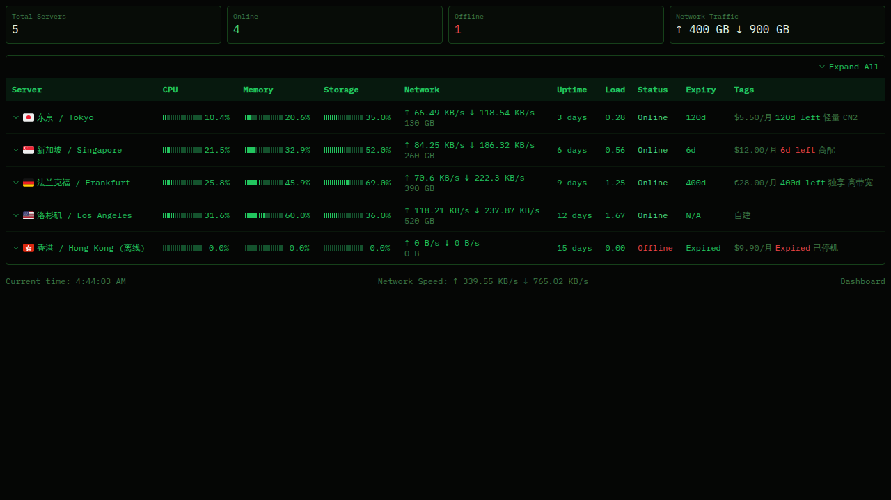

<div align="center">



# Komari ASCII

一款为 [Komari](https://github.com/komari-monitor/komari) 设计的终端 / ASCII 风格主题。

[](https://github.com/facl/komari-ascii/releases)
[](./LICENSE)

</div>

## 特性

- 终端风格界面：黑底绿字、等宽字体、分段式进度条
- 顶部统计栏：服务器总数 / 在线 / 离线 / 总流量
- 服务器表格：国旗、CPU / 内存 / 磁盘、网速与流量、运行时间、负载、状态、到期时间、标签（价格 / 剩余天数 / 自定义标签）
- 点击行展开详情：系统 / 硬件 / 用量 / Agent 信息，以及各 Ping 任务的延迟与丢包率
- 页脚实时时钟与总网速，附 Dashboard 管理入口
- 支持 Komari 私有站点、JSON-RPC2、搜索、分组等原有功能

## 界面预览


## 安装

### 方式一：上传主题包

1. 下载主题包（ Releases 或自行构建，见下文）；
2. 在 Komari 管理端 → 主题管理 中上传 zip；
3. 点击「设为当前主题」。

### 方式二：自行构建

```bash
git clone https://github.com/facl/komari-ascii.git
cd komari-ascii
npm install
npm run build

# 打包主题 zip（zip 根目录需包含 komari-theme.json、preview.png 和 dist/）
mkdir -p stage/dist
cp -r dist/index.html dist/assets stage/dist/
cp komari-theme.json preview.png stage/
cd stage && zip -r ../komari-ascii.zip .
```

> 注意：zip 内必须保持 `komari-theme.json`、`preview.png` 在根目录，`index.html` 与 `assets/` 位于 `dist/` 目录下，否则 Komari 无法正确加载主题。

## 开发

```bash
npm install
npm run dev    # 开发模式自带 mock 数据，无需后端即可预览
```

## 致谢

- 界面移植自 Nezha v1 主题 [hamster1963/nezha-ascii](https://github.com/hamster1963/nezha-ascii)

## 许可证

本项目采用 [MIT License](LICENSE) 授权。
